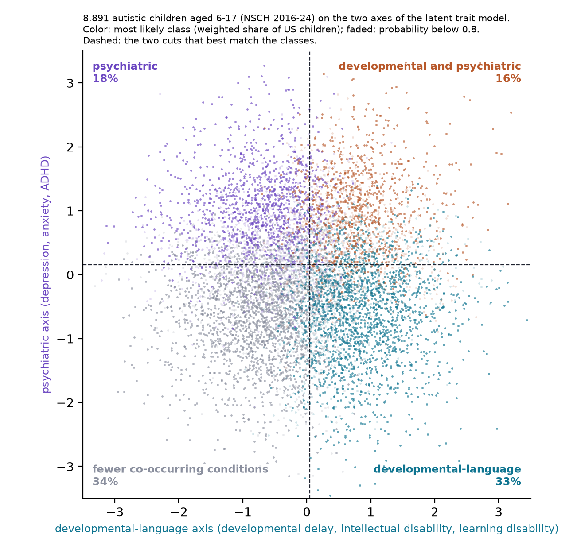

# Do autistic children fall into distinct subtypes?

[](https://github.com/Naalu/nsch-autism-subtypes/actions/workflows/ci.yml)
[](LICENSE)

Autism is one diagnosis that covers very different children. Studies of hospital and clinic records keep finding three or four "subtypes" based on which other conditions a child has (ADHD, anxiety, epilepsy, and so on), but almost none of them check whether the same groups appear in a second, independent set of children, and none ask whether a continuum would pass that check too.

This project asks the question on a national survey instead: ten years of the National Survey of Children's Health (2016 to 2025), 11,370 autistic children aged 6 to 17 (8,891 with complete answers in the 2016 to 2024 fitting sample, 1,505 more in 2025), and 18 parent-reported co-occurring conditions. We look for groups with a latent class model, fit by our own NumPy implementation (the StepMix library reproduces it at ARI 0.99), then put the groups through checks we fixed in advance:

- a second clustering method has to find the same groups;
- the groups have to come back in later survey years, including the 2025 file, which no modeling choice was made on;
- each group has to survive resampling;
- the groups have to tell us more about parent-rated severity than counting a child's conditions does.

We also fit a model with no groups, in which children vary along a few continuous scales, and ask which description the data prefer. And because a partition of a smooth continuum can also come back in new children, we run every check on simulated data with and without real groups, to see what a pass can and cannot show.

The short answer: the conditions vary along two continuous axes. Four broad profiles, the combinations of high and low on a developmental-language axis and a psychiatric axis, come back in later years, in 2025 and under resampling, but only as well as the same cut of a smooth continuum would. The continuous model fits better and predicts new years as well as eight classes. Parent-rated severity rises along the developmental axis and does not jump at the class borders.



Course project for CS 472/572 (Unsupervised Learning) at Northern Arizona University, fall 2026. Chris Reger and Haley Berger.

## New here? Read in this order

1. `docs/background.md`: the question, the survey, and every method in plain language, with a glossary. No statistics background assumed.
2. `reports/data-overview.md`: what the data looks like, raw and processed, with figures.
3. The numbered scripts in `scripts/`, in order. Each begins with a summary of what it does and why.
4. `docs/validation-checklist.md`: what every check found, the decisions made after seeing results, and how the design compares with published subtyping studies.
5. `paper/`: the write-up, built with `make paper`.

For working on the code: `docs/implementation.md` (how our implementations work and are tested), `docs/outputs.md` (every file the pipeline writes, and how to add a condition or a check) and `reports/implementation-comparison.md` (our code against StepMix, SciPy and scikit-learn).

## What's here

```
config/conditions.yaml        the 18 conditions, the survey items behind each, and every item left out, with reasons
data/processed/               the analysis table (committed), codebook, selection counts
src/nsch_subtypes/            the package
  data.py, config.py          download, select children, build the 0/1 flags (steps 1 and 2)
  lca.py                      latent class model fit by EM, from scratch
  hierarchical.py             Jaccard distance and average linkage, from scratch
  partition.py                k-means, from scratch
  latent_trait.py             the continuous alternative: a binary factor model with 1 to 4 dimensions, from scratch
  reference.py, backends.py   StepMix, SciPy and scikit-learn versions, and the switch between theirs and ours
  validate.py                 agreement, replication, stability, and the count-vs-class test
  describe.py                 survey-weighted national shares with confidence intervals
  synthetic.py, plots.py      made-up data for tests; shared figure styling
scripts/
  01_select.py ... 16_outcomes.py   one pipeline step each (table below)
  sweep_k.sh                  runs steps 4 to 16 at several K
  make_results_figures.py     draws reports/figures/results/ and writes reports/tables/
  make_data_overview.py, compare_backends.py       the data overview and the backend comparison
reports/
  figures/results/, tables/   the results figures and the tables every reported number comes from
  data-overview.md            the data in raw and processed form, with figures
  implementation-comparison.md   our code against the library versions
paper/                        the paper (LaTeX, one file per section; make paper) and its outline
docs/                         background, implementation, validation checklist, outputs, team notes
tests/                        unit tests on synthetic data; an end-to-end smoke test and a real-data regression test (make smoke)
```

## Run it

Needs Python 3.11 or later and [uv](https://docs.astral.sh/uv/).

```bash
git clone https://github.com/Naalu/nsch-autism-subtypes
cd nsch-autism-subtypes
uv sync --group dev
make test                      # unit tests on synthetic data (under a minute)
make smoke                     # every step once at tiny settings (about 5 minutes)
make fit                       # step 3: latent class models K = 1 to 8 (about 5 minutes)
make sweep                     # steps 4 to 16 at K = 4 to 8, then the figures (4 to 5 hours)
make paper                     # build paper/main.pdf (needs LaTeX)
make download                  # optional: rebuild the analysis table from the Census files (about 60 MB)
```

Without uv, `requirements.txt` pins the same versions as `uv.lock`: `python -m venv .venv`, activate it, `pip install -r requirements.txt -e .`, then run the pipeline targets with `make fit PY=python` and so on. Regenerate it after changing dependencies with `uv export --format requirements-txt --no-hashes --no-dev --no-emit-project -o requirements.txt`.

`data/processed/analysis.parquet` is committed, so nothing needs the download. `make` uses our from-scratch NumPy code by default; add `BACKEND=reference` to run the StepMix / SciPy / scikit-learn versions instead, which write to `results_reference/` so they never overwrite the main run. Every script takes `--help`. Outputs go to `results/` and `results_k{K}/`; `docs/outputs.md` lists them.

The survey can also be read through the [nsch](https://github.com/NAU-ASD3/nsch-py) package: `uv sync --extra nsch`, then `scripts/01_select.py --loader nsch`. That path is experimental until nsch publishes a release.

## The pipeline

| Step | Script | What it does | Pass line |
|---|---|---|---|
| 1 Select | `01_select.py` | Children aged 6 to 17 whose parent says they currently have autism, every year 2016 to 2025 | |
| 2 Encode | `02_encode.py` | One 0/1 flag per condition; items dropped if they changed wording, left the survey, or are under 1% prevalence | |
| 3 Group | `03_fit_lca.py` | Latent class model for K = 1 to 8, 20 random starts each; BIC, entropy and a column-shuffled baseline. Does not choose K | |
| 4 Cross-check | `04_crosscheck.py` | A second method (k-means; the proposal's hierarchical method; six others) cut at the same K, compared with the adjusted Rand index | ARI ≥ 0.65 |
| 5 Replicate | `05_replicate.py` | Fit on 2016 to 2021, refit on 2022 to 2024, both label the 2022 to 2024 children | ARI ≥ 0.65 |
| 6 Resample | `06_bootstrap.py` | 200 bootstrap refits; how much of each class comes back | mean Jaccard ≥ 0.75 |
| 7 Describe | `07_describe.py` | Weighted national share of each class with 95% CI; severity, age and sex by class; count-vs-class test | |
| 8 Forward | `08_forward_2025.py` | Frozen 2016 to 2024 model against a fresh fit on 2025 | ARI ≥ 0.65 |
| 9 Age bands | `09_age_bands.py` | Refit within ages 6 to 11 and 12 to 17; compare with the pooled classes | ARI ≥ 0.65 |
| 10 Parallel | `10_parallel_ever.py` | Refit on flags built from the "ever told" items | ARI ≥ 0.65 |
| 11 Robustness | `11_robustness.py` | Survey-weighted fit, dropped-children comparison, seed sensitivity | |
| 12 Dimensions | `12_dimensions.py` | Latent trait models with 1 to 4 dimensions against the classes; pairwise fit; simulations from each model | |
| 13 Choose | `13_heldout_selection.py` | Held-out likelihood for every model on later years; K = the largest K whose classes all come back under resampling | |
| 14 Calibrate | `14_shape_and_stability.py` | The stability and latent-shape checks on simulated data with no classes and with real classes, as a yardstick | |
| 15 Calibrate | `15_replication_calibration.py` | The replication checks (steps 4, 5, 8, 9) on simulated data with no classes and with real classes | |
| 16 Outcomes | `16_outcomes.py` | Step 7's test on three held-out outcomes (severity, forgone care, ER visits), scored on 2025 too; whether the class links changed in the pandemic years; the classes refit without 2020 and 2021 | Weighted rates by class |

`make sweep` (or `scripts/sweep_k.sh 4 5`) runs steps 4 to 12, 15 and 16 at each K into `results_k{K}/`, then steps 13 and 14 and `scripts/make_results_figures.py`.

Steps 1 to 3 are a complete project on their own. Steps 4, 5, 8, 9 and 10 are independent checks of the classes from step 3; step 6 is the stability check that also decides K; 11 and 12 ask whether the modeling choices and the class description itself hold up; 13 asks how much structure carries over to new children; 14 and 15 measure what the checks score when the answer is known; 16 asks what the classes predict. Step 7 turns the result into national numbers. Survey weights are used only to describe the classes (steps 7 and 8, and the weighted-fit check in 11), never to fit the main model.

The pass lines and the planned null result (the count test) were set in the project proposal on October 13, 2026, before any model was fit. The rule for K was set after BIC failed to settle; `docs/validation-checklist.md` explains both.

## The data

Public files from the [Census Bureau](https://www.census.gov/programs-surveys/nsch/data/datasets.html); no application needed. `reports/data-overview.md` walks through them: what the raw rows look like, how selection and encoding work, how common each condition is, how conditions go together, and what the models see.

Two things to know up front. The flags are parent reports of a doctor's diagnosis ("a doctor told me, and my child currently has it"), so they mix having a condition with having had access to care. And each child appears once, so we can describe groups but not how a child moves between them. The files have no identifiers, and no IRB review was required.

## What we found

Details in `docs/validation-checklist.md` and the paper; figures in `reports/figures/results/`; every number in `reports/tables/`.

- BIC kept falling through K = 8, and so did held-out likelihood, so neither picks a K. K was chosen after the fact as the largest K at which every class is bootstrap-stable. That is K = 4. Simulation shows that a smooth continuum with no groups is also stable at K = 4 and 5, so this K means "the finest division that comes back reliably", not proof of four groups.
- The four classes are the combinations of high and low on two axes, developmental-language and psychiatric. Weighted shares of U.S. autistic children aged 6 to 17: fewer co-occurring conditions 34%, developmental-language 33%, psychiatric 18%, both 16%.
- The partition reproduces across survey years (ARI 0.71), in the 2025 file (0.79), within age bands (0.71, 0.77) and under resampling (Jaccard 0.91 or better). The "ever told" items agree at 0.66, just over the line. The second-method check fails (k-means ARI 0.54); the disagreement is about children near a border.
- Those scores are what a four-way partition of a smooth continuum produces. Run on data simulated from the two-dimensional model, with no classes in it, the same checks score 0.66 to 0.85, 0.56 to 0.78, 0.56 to 0.95 and 0.44 to 0.54; data simulated with four real classes score 0.78 to 0.95, 0.81 to 0.91, 0.93 to 0.98 and 0.57 to 0.60. The real data replicate like the continuum (`reports/figures/results/replication_vs_simulation.png`).
- Parent-rated severity follows the developmental-language axis and not the psychiatric one. Classes add to a plain condition count, but two continuous scores predict severity better than the classes do.
- A two-dimensional latent trait model fits better than any number of classes and predicts new survey years as well as eight classes with a third of the parameters. A third dimension picks up medical and sensory conditions, the same signal as a small fifth class that does not hold together under resampling. Finer class solutions fail replication.
- Estimated from the data, the distribution of children on the two scales is lumpier than a bell curve but about half as lumpy as four separate groups would make it: some concentration at typical combinations on top of continuous variation. The map of children in that space (`reports/figures/results/map.png`) shows one cloud with the classes as regions of it.

## Methods and sources

Latent class model fit by EM (Dempster, Laird and Rubin 1977); BIC (Nylund, Asparouhov and Muthén 2007); K by cluster stability (Ben-Hur, Elisseeff and Guyon 2002; Lange et al. 2004); classes against continuous factors (Bauer and Curran 2004; Lubke and Neale 2006; Markon and Krueger 2006); average linkage (Sokal and Michener 1958); adjusted Rand index (Hubert and Arabie 1985) and its interpretation bands (Steinley 2004); bootstrap cluster stability (Hennig 2007); subtyping validation checklist (Agelink van Rentergem, Deserno and Geurts 2021). Clinic-based subtyping studies we compare against: Doshi-Velez, Ge and Kohane 2014; Lingren et al. 2016; Vargason et al. 2019; Montgomery et al. 2023; Litman et al. 2025.

Reference implementations: [StepMix](https://github.com/Labo-Lacourse/stepmix) (Morin et al. 2025), [SciPy](https://scipy.org), [scikit-learn](https://scikit-learn.org). Variable naming follows the [nsch](https://github.com/NAU-ASD3/nsch) and [nsch-py](https://github.com/NAU-ASD3/nsch-py) packages; the cross-year item audit used the [CAHMI crosswalk](https://www.childhealthdata.org/).

## Citing the data

National Survey of Children's Health, 2016 to 2025. U.S. Census Bureau for the Health Resources and Services Administration's Maternal and Child Health Bureau. Public-use files.

## License

MIT. See `LICENSE`.
