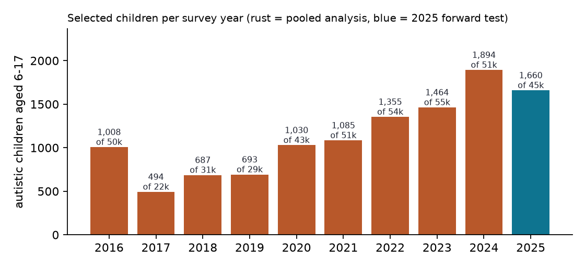
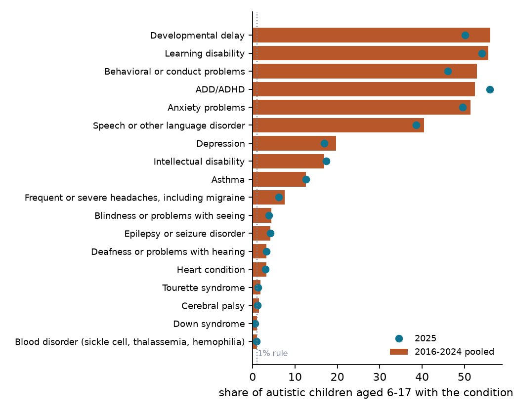
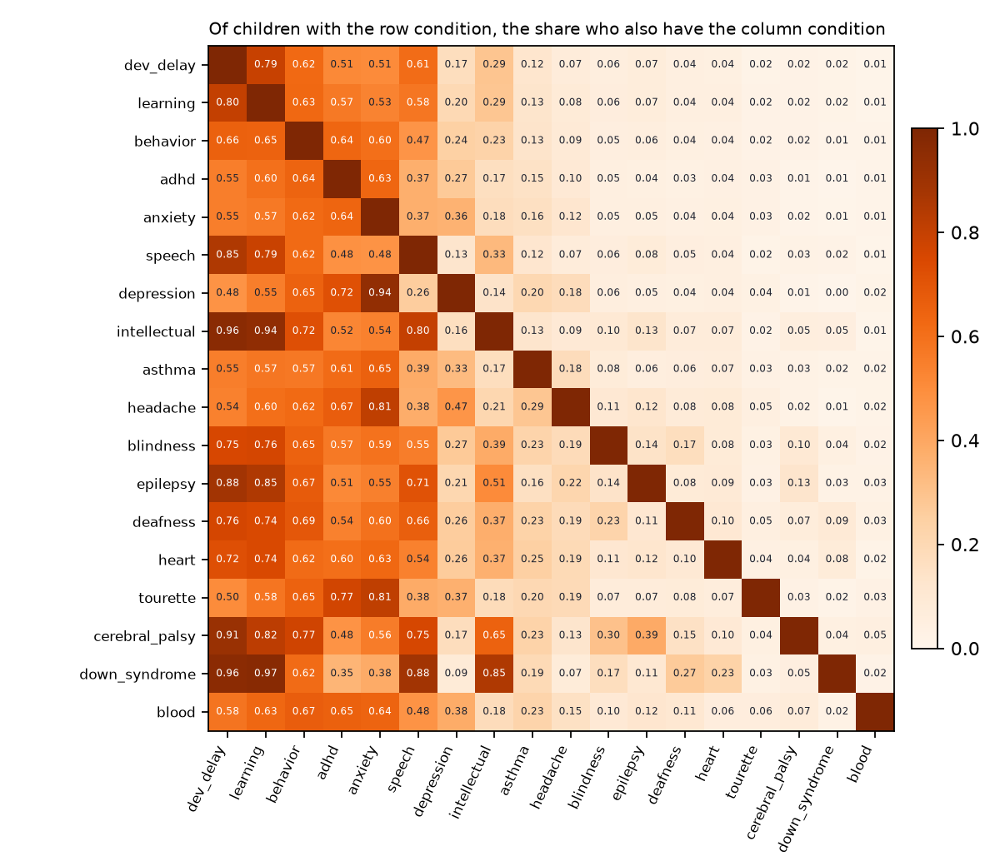
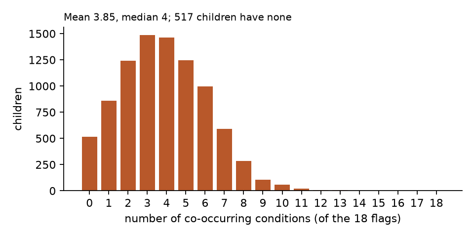
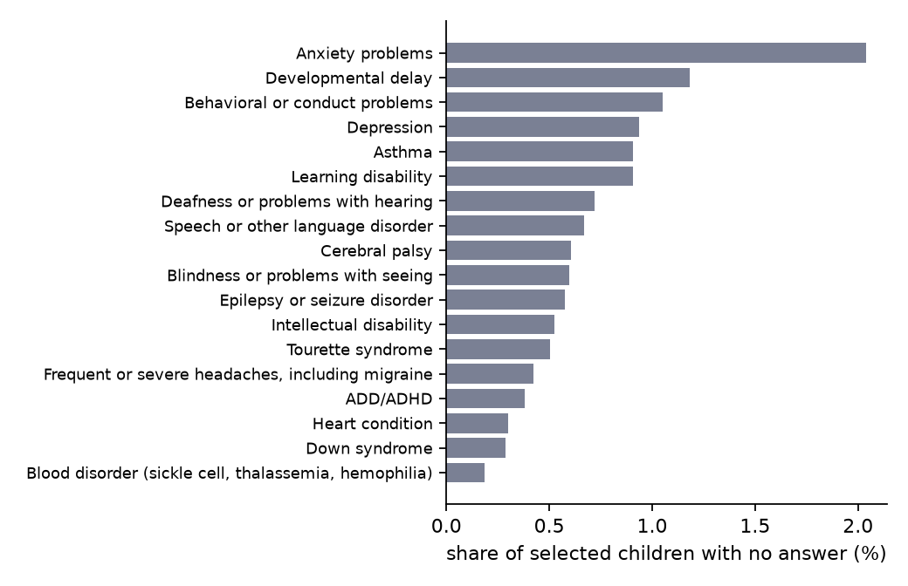

# The data, raw and processed

What the National Survey of Children's Health looks like as it comes from the Census Bureau, what we keep, and what the models see. Numbers are from the build of October 19, 2026 (`make data`). Figures are in `figures/`, tables in `tables/`.

## 1. Where the data comes from

The NSCH is a yearly household survey run by the Census Bureau for HRSA's Maternal and Child Health Bureau. A household is sampled by address, one child is picked, and a parent or caregiver answers a questionnaire about that child, online or on paper. There are three questionnaire forms by age (0-5, 6-11, 12-17); the condition items we use are worded the same on all three.

Each year is published as one "topical" file. We read the Stata release (`nsch_{year}_topical_Stata.zip`), which holds a `.dta` data file and a `.do` file with every variable and value label. The files are public and need no application. `scripts/01_select.py --download` fetches them from `https://www2.census.gov/programs-surveys/nsch/datasets/{year}/`; one year is 5-7 MB zipped and 10-28 MB unzipped.

| Year | File | Children | Columns |
|---|---|---|---|
| 2016 | nsch_2016e_topical.dta | 50,212 | 432 |
| 2017 | nsch_2017e_topical.dta | 21,599 | 436 |
| 2018 | nsch_2018e_topical.dta | 30,530 | 447 |
| 2019 | nsch_2019e_topical.dta | 29,433 | 448 |
| 2020 | nsch_2020e_topical.dta | 42,777 | 447 |
| 2021 | nsch_2021e_topical.dta | 50,892 | 462 |
| 2022 | nsch_2022e_topical.dta | 54,103 | 484 |
| 2023 | nsch_2023e_topical.dta | 55,162 | 456 |
| 2024 | nsch_2024e_topical.dta | 51,375 | 457 |
| 2025 | nsch_2025e_topical.dta | 45,139 | 458 |

Ten files, 431,222 children. 2023's archive is named `nsch_2023e_topical_Stata.zip`, unlike the other years; the downloader reads the index page instead of guessing.

## 2. Raw rows

Five children from the 2024 file, as Census ships them (`tables/raw_rows_2024.csv`; a few of the ~450 columns). Variable names are the questionnaire item numbers. Coding is 1 = yes, 2 = no, blank = not asked or not answered. Follow-up items (`k2q31b`, "does this child CURRENTLY have ADHD?") are blank whenever the parent said no to the "ever told" item (`k2q31a`).

| hhid | sc_age_years | sc_sex | fwc | stratum | fipsst | k2q35a | k2q35b | k2q35c | k2q31a | k2q31b | k2q33a | k2q33b | k2q42a | k2q42b | k2q61a | downsyn |
|---|---|---|---|---|---|---|---|---|---|---|---|---|---|---|---|---|
| 24000422 | 8 | 1 | 640.5 | 1 | 45 | 1 | 1 | 3 | 2 | | 1 | 1 | 2 | | 1 | 2 |
| 24002281 | 8 | 1 | 1446.2 | 1 | 39 | 1 | 1 | 3 | 2 | | 2 | | 2 | | 1 | 2 |
| 24005972 | 11 | 2 | 467.7 | 1 | 45 | 1 | 1 | 1 | 1 | 1 | 2 | | 2 | | 2 | 2 |
| 24008138 | 16 | 1 | 1368.1 | 1 | 29 | 1 | 1 | 2 | 1 | 1 | 2 | | 2 | | 2 | 2 |
| 24012773 | 15 | 2 | 3427.7 | 1 | 12 | 1 | 1 | 2 | 1 | 1 | 1 | 1 | 2 | | 2 | 2 |

What the columns are:

- `hhid`: household id. `sc_age_years`, `sc_sex` (1 male, 2 female): the selected child.
- `fwc`: the child's survey weight, how many US children this child stands for. `stratum` and `fipsst` (state) define the sampling design.
- `k2q35a`: ever told the child has autism or ASD. `k2q35b`: currently has it. `k2q35c`: parent-rated severity, 1 mild, 2 moderate, 3 severe.
- `k2q31a`/`k2q31b`: ADHD ever / currently. `k2q33a`/`k2q33b`: anxiety. `k2q42a`/`k2q42b`: epilepsy. `k2q61a`: cerebral palsy (ever; the follow-up was dropped in 2022). `downsyn`: Down syndrome (ever only).

## 3. Selection

Two filters, applied per year (`scripts/01_select.py`): age 6-17, and `k2q35b == 1` (currently has ASD). "Currently" rather than "ever" avoids children whose diagnosis was later ruled out; ages 6-17 share the questionnaire forms on which the condition items sit and are old enough for most conditions to have been diagnosed. `data/processed/selection_counts.csv` has every count.

| Year | Children | Aged 6-17 | Ever told ASD | Currently has ASD (selected) |
|---|---|---|---|---|
| 2016 | 50,212 | 35,718 | 1,097 | 1,008 |
| 2017 | 21,599 | 15,438 | 534 | 494 |
| 2018 | 30,530 | 21,954 | 730 | 687 |
| 2019 | 29,433 | 21,259 | 738 | 693 |
| 2020 | 42,777 | 30,636 | 1,096 | 1,030 |
| 2021 | 50,892 | 30,173 | 1,159 | 1,085 |
| 2022 | 54,103 | 34,362 | 1,456 | 1,355 |
| 2023 | 55,162 | 33,638 | 1,546 | 1,464 |
| 2024 | 51,375 | 37,534 | 1,999 | 1,894 |
| 2025 | 45,139 | 33,039 | 1,749 | 1,660 |

Pooled 2016-2024: 9,710 children for the main analysis. 2025: 1,660 children, held out for the forward test. The unweighted share of 6-17-year-olds whose parent reports current ASD rises from 2.8% in 2016 to 5.0% in 2024 and 2025, which matches the national trend in parent-reported diagnosis and is one reason to check that the classes hold across years.

## 4. Encoding

One flag per condition (`scripts/02_encode.py`, rule in `nsch_subtypes.data.encode_flag`):

| ever | currently | flag |
|---|---|---|
| no | (not asked) | 0 |
| yes | yes | 1 |
| yes | no | 0 |
| yes | (no follow-up item for this condition) | 1 |
| blank, or yes with a blank follow-up | | missing |

Cerebral palsy, blood disorders, Down syndrome, deafness and blindness have no "currently" item in the survey; they are lifelong or structural, so "ever" is the flag.

Which items are in is decided in `config/conditions.yaml`, with a reason for every exclusion. We audited each item against the CAHMI 2016-present crosswalk and the per-year `.do` files:

- **Dropped from the survey**: arthritis (gone in 2022), brain injury (2020), "other genetic condition" (2023).
- **Added to the survey**: diabetes (2022).
- **Wording changed**: allergies, 2022, "including food, drug, insect, or other" became "such as food, drug, insect, seasonal, or other". The reported rate moved from 33.7% in 2021 to 38.5% in 2022. Dropped.
- **Below the prevalence rule**: cystic fibrosis, 0.12% of the pooled sample. The rule is at least 1% of the pooled 2016-2024 autistic sample (`min_prevalence` in the config).

That leaves 18 flags. The codebook (`data/processed/codebook.csv`) records, for every configured item, whether it was kept, its pooled prevalence and missing rate, and the reason if not.

## 5. Processed rows

The same five children after encoding (`tables/processed_rows_2024.csv`):

| hhid | year | age | sex | weight | severity | adhd | anxiety | depression | behavior | dev_delay | intellectual | speech | learning | tourette | asthma | epilepsy | headache | heart | cerebral_palsy | blood | down_syndrome | deafness | blindness |
|---|---|---|---|---|---|---|---|---|---|---|---|---|---|---|---|---|---|---|---|---|---|---|---|
| 24000422 | 2024 | 8 | male | 640.5 | severe | 0 | 1 | 0 | 1 | 1 | 0 | 1 | 1 | 0 | 0 | 0 | 0 | 0 | 1 | 0 | 0 | 0 | 1 |
| 24002281 | 2024 | 8 | male | 1446.2 | severe | 0 | 0 | 0 | 1 | 1 | 0 | 1 | 1 | 0 | 0 | 0 | 0 | 0 | 1 | 0 | 0 | 1 | 0 |
| 24005972 | 2024 | 11 | female | 467.7 | mild | 1 | 0 | 0 | 1 | 0 | 0 | 0 | 1 | 0 | 1 | 0 | 0 | 0 | 0 | 0 | 0 | 0 | 0 |
| 24008138 | 2024 | 16 | male | 1368.1 | moderate | 1 | 0 | 0 | 0 | 0 | 0 | 0 | 0 | 0 | · | 0 | 0 | 0 | 0 | 0 | 0 | 0 | 0 |
| 24012773 | 2024 | 15 | female | 3427.7 | moderate | 1 | 1 | 1 | 1 | 0 | 0 | 0 | 1 | 0 | 0 | 0 | 0 | 0 | 0 | 0 | 0 | 1 | 0 |

The fourth child has a missing asthma flag (·): the parent said the child had been told they have asthma but did not answer whether they currently do. The models only see the 18 flag columns; `severity`, `age`, `sex` and `weight` are held out and used afterward to describe the classes.

`data/processed/analysis.parquet` holds all 11,370 selected children with missing values kept as missing. The modeling scripts drop children with any missing flag: 8,891 of 9,710 remain for 2016-2024 (8.4% dropped) and 1,505 of 1,660 for 2025.

## 6. What the flags look like

Six conditions are common (40-56%): developmental delay, learning disability, behavioral problems, ADHD, anxiety, speech disorder. Depression, intellectual disability and asthma sit at 12-20%. The rest are under 8%. The 2025 points track the pooled bars; ADHD is up a little (56.0% vs 52.4% pooled) and behavioral problems down (46.1% vs 53.0%), both continuing trends visible in `tables/prevalence_by_year.csv`.

Read a row as "of children with this condition, the share who also have the column condition". Almost every child with intellectual disability also has developmental delay (0.96) and learning disability (0.94). Depression goes with anxiety (0.94) and ADHD (0.72). The common conditions form a block in the upper left; the rare physical conditions (epilepsy, cerebral palsy, Down syndrome, deafness) co-occur mostly with developmental delay and speech. This is the structure the clustering methods are looking for.

Children have 3.9 conditions on average. 517 (5.8%) have none of the 18. These children are identical to each other on every input, which matters for hierarchical clustering: they form one tight group at Jaccard distance 0 that sits at distance 1 from everyone else.

The 8,891 complete rows collapse to 1,347 distinct condition profiles. The ten most common (`tables/top_profiles.csv`):

| Profile | Children |
|---|---|
| none | 517 |
| dev_delay, speech, learning | 219 |
| adhd | 210 |
| anxiety | 202 |
| behavior, dev_delay, speech, learning | 197 |
| adhd, behavior | 174 |
| adhd, anxiety, behavior | 159 |
| adhd, anxiety, behavior, dev_delay, speech, learning | 156 |
| adhd, anxiety | 147 |
| adhd, anxiety, depression, behavior | 129 |

No flag is missing for more than 2.1% of children (anxiety, mostly parents who answered "ever" but not "currently"). Severity is missing for 77 of the 9,710.

## 7. Limits of the data

- Every flag is parent report of a provider's diagnosis: "a doctor told me, and my child currently has it". It mixes prevalence with access to diagnosis.
- Each child appears once (cross-sectional), so we can describe groups, not movement between them.
- Pooling nine years assumes the links between conditions are stable over 2016-2024. The held-out-year checks test that.
- Weights (`fwc`) are used only to describe the classes, never to fit them. For pooled estimates each weight is divided by the number of years pooled.
