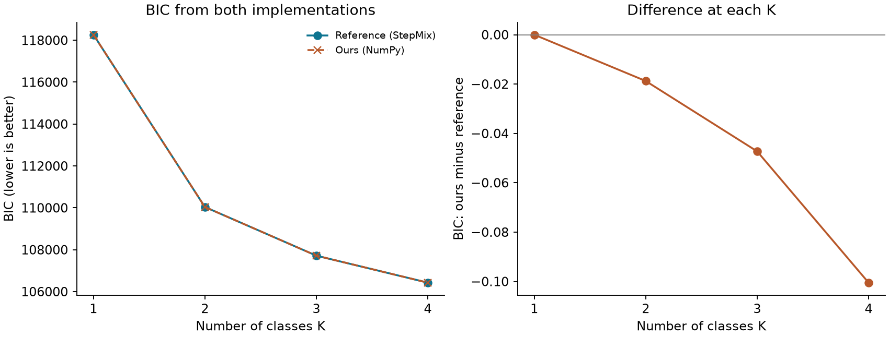
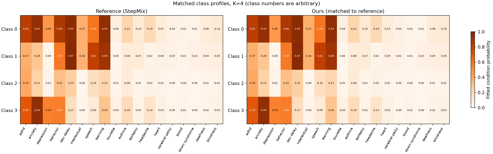
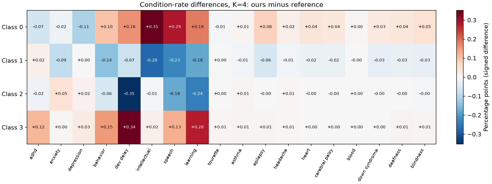

# Comparing the from-scratch and reference implementations

Do the two implementations fit the same latent class model? This report compares saved NumPy and StepMix
fits on the same children and condition flags. Classes are matched by their fitted condition rates before
comparing profiles; their original numbers are arbitrary.

## What was compared

- K values: 1, 2, 3, 4; profile diagrams use K=4.
- Children: 8,891, ages 6 to 17, survey years 2016 to 2024. The 2025 holdout is excluded.
- Settings: reference: 20 starts, seed 0, max 2000 iterations, ours: 20 starts, seed 0, max 2000 iterations.
- All compared fits converged.

Our code writes to `results/` and StepMix to `results_reference/`; `scripts/compare_backends.py` reads
those by default and refuses fits with different children, row order or condition order. [The summary
table](tables/backend_comparison.csv) contains every shared K; [the condition-rate
table](tables/backend_condition_rates.csv) contains the matched chart values.

## What the comparison found

At K=4, adjusted Rand index (ARI) is **0.988052**. ARI measures agreement between class
assignments after allowing for arbitrary class numbering; it is not a percentage of correctly classified
children. The absolute log-likelihood gap is **0.050244**. The largest matched condition-rate
gap is **0.3518 percentage points**.

The two implementations can reach different local optima and stop at different times. Equal seed values
do not produce identical initializations across libraries. These comparisons measure agreement; they do
not establish that the latent classes are real subtypes or choose K.

### Model fit

The left panel overlays BIC from both implementations. The right panel shows the small differences that
the main BIC scale can hide. A negative difference means lower BIC for ours.

### Matched profiles

Both panels use the same probability scale and reference class order. Values are fitted condition
probabilities, rather than raw within-class percentages.

### Condition-rate differences

Positive values mean a higher rate in ours; negative values mean a higher rate in the reference. The
units are percentage points, and the color scale is centered at zero.

## What the numbers in the repository come from

Every number in the README, the validation checklist and the paper comes from the from-scratch code
(`results/` and `results_k*/`). The StepMix fits in `results_reference/` are the check on it; rerunning
`make compare` after a sweep refreshes this report's tables and figures for every K both backends fit.
