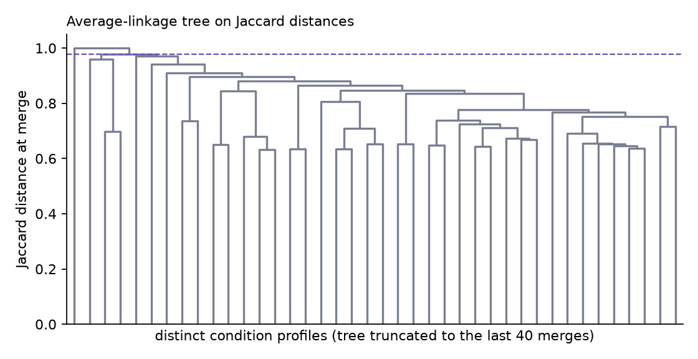
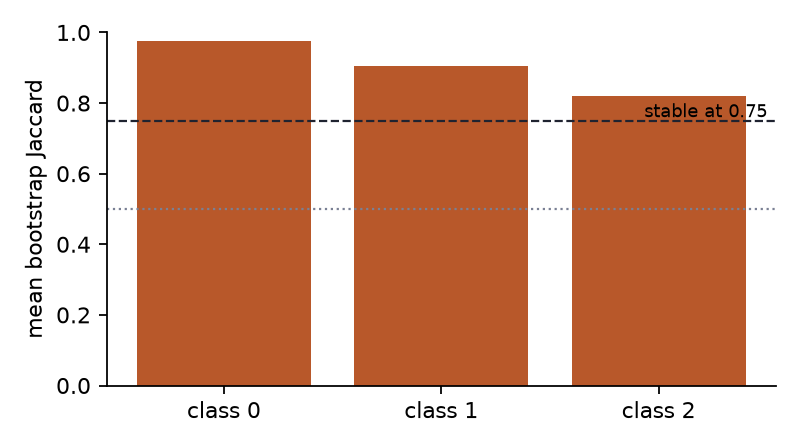

# Comparing the from-scratch and reference implementations

Do the two implementations fit the same latent class model? This report compares saved NumPy and StepMix
fits on the same children and condition flags. Classes are matched by their fitted condition rates before
comparing profiles; their original numbers are arbitrary.

## What was compared

- K values: 1, 2, 3, 4; profile diagrams use K=4.
- Children: 8,891, ages 6 to 17, survey years 2016 to 2024. The 2025 holdout is excluded.
- Settings: reference: 20 starts, seed 0, max 2000 iterations, ours: 20 starts, seed 0, max 2000 iterations.
- All compared fits converged.

The saved fits were in `results/` (reference) and `results_ours/` (ours) when this comparison was run. Since November our code writes to `results/` and StepMix to `results_reference/`, and `scripts/compare_backends.py` reads those by default. [The summary
table](tables/backend_comparison.csv) contains every shared K; [the condition-rate
table](tables/backend_condition_rates.csv) contains the matched chart values.
`results_ours/backend_comparison.json` records input locations and settings. The comparison script
refuses fits with different children, row order, or condition order.

## What the comparison found

At K=4, adjusted Rand index (ARI) is **0.988052**. ARI measures agreement between class
assignments after allowing for arbitrary class numbering; it is not a percentage of correctly classified
children. The absolute log-likelihood gap is **0.050244**. The largest matched condition-rate
gap is **0.3518 percentage points**.

The two implementations can reach different local optima and stop at different times. Equal seed values
do not produce identical initializations across libraries. These comparisons measure agreement; they do
not establish that the latent classes are real subtypes or choose K.

### Model fit

The left panel overlays BIC from both implementations. The right panel shows the small differences that
the main BIC scale can hide. A negative difference means lower BIC for ours.

### Matched profiles

Both panels use the same probability scale and reference class order. Values are fitted condition
probabilities, rather than raw within-class percentages.

### Condition-rate differences

Positive values mean a higher rate in ours; negative values mean a higher rate in the reference. The
units are percentage points, and the color scale is centered at zero.

## Verification and limits

The initial verification of the added-from-scratch copy passed all 54 unit tests, before this report and
its comparison tests were added. Targeted real-data checks also completed both LCA backends, weighted
hierarchical clustering, k-means, replication, and a small bootstrap. The copy's executable Python code
matched the previously verified version, whose two full pipeline smoke tests passed. The full slow suite
was not repeated on this copy.

Two existing test-file style issues remain: import spacing in `tests/test_implementations.py` and an
overlong line in `tests/test_pipeline_smoke.py`. They affect lint, not the passing unit tests. The full
200-resample, multi-K research sweep has not been rerun. Reduced-start verification runs are separate
from the fits compared above and must not be quoted as final research estimates.

## Earlier small verification run

The diagrams below use K=3 from the initial integration check. The LCA fit
used three starts. The bootstrap used just three resamples and two starts
per refit. These settings check that the program runs; they do not provide
final research estimates of class stability.

[The verification stability table](tables/backend_comparison/verification_k3_stability.csv)
contains the plotted values. The original check record and raw artifacts are
archived under `results_ours/verification/`. All `verification_k3_` figures and
tables come from that earlier run, separate from the 20-start comparison.
